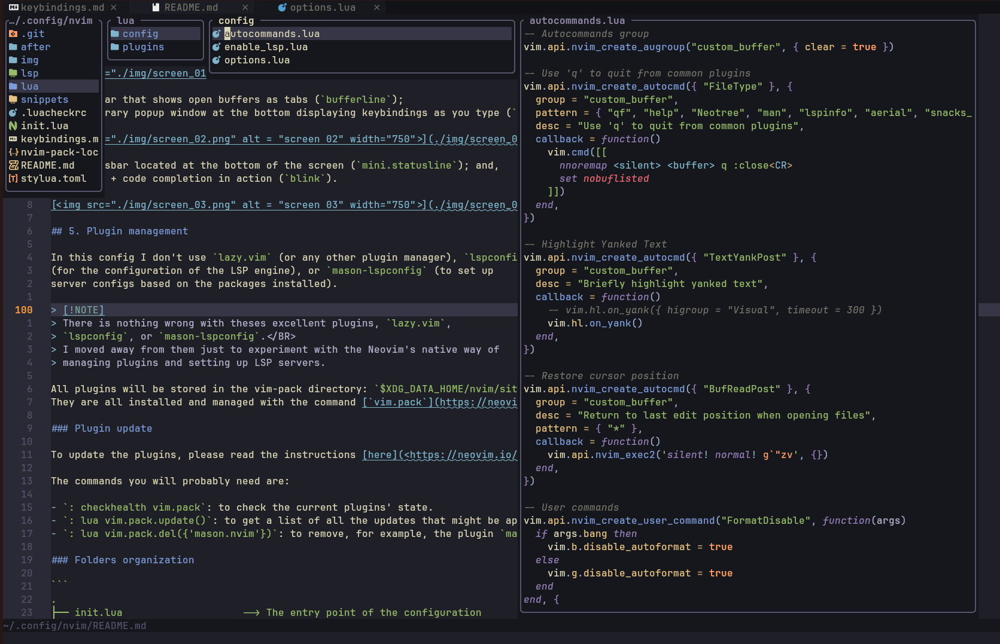
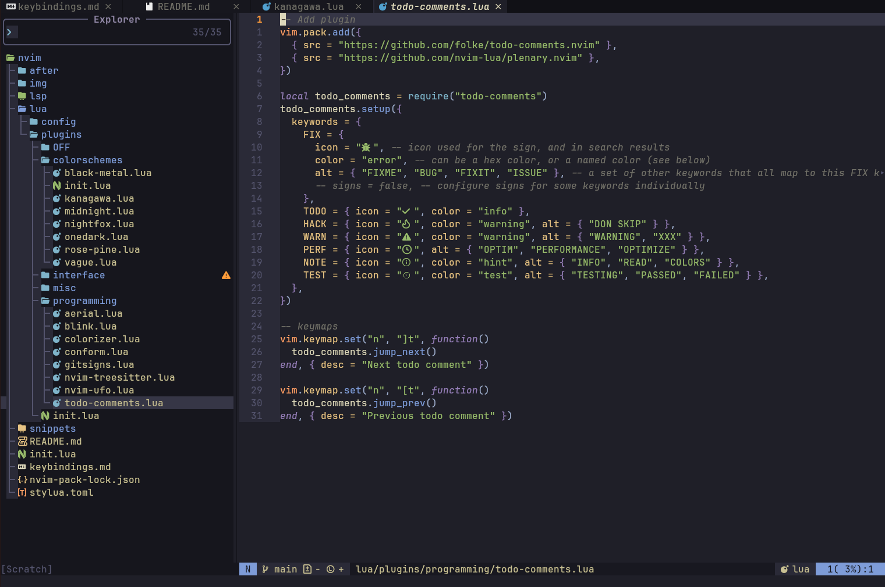
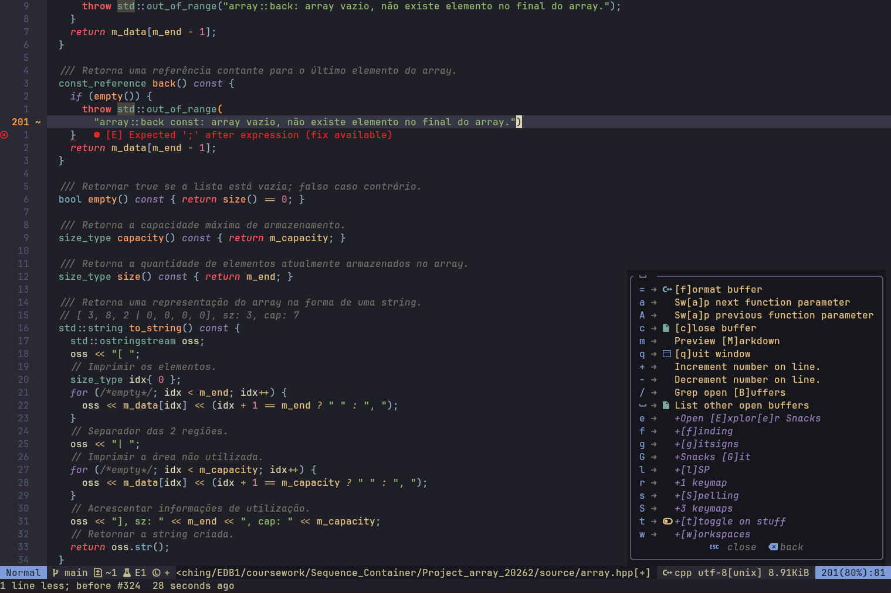
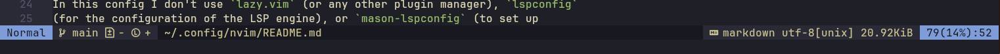
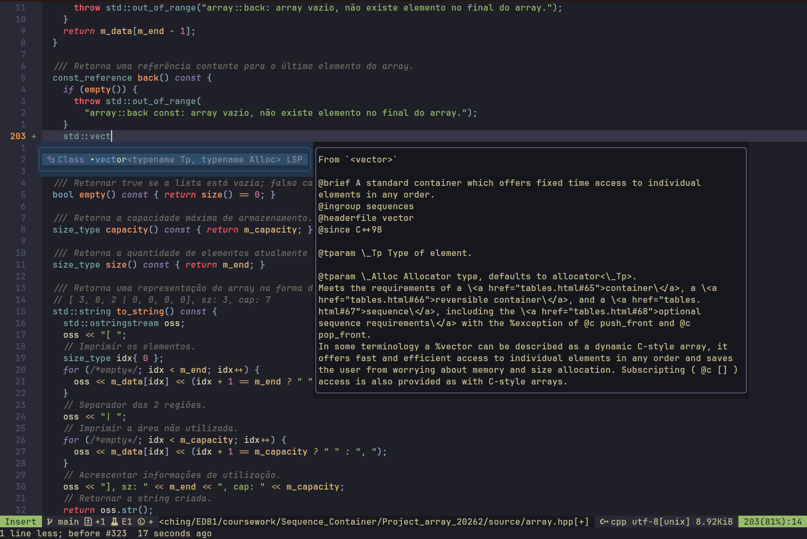

**Summary**

<!--toc:start-->

- [1. Introduction](#1-introduction)
- [2. Installation](#2-installation)
- [3. Keybindings](#3-keybindings)
- [4. Features](#4-features)
- [5. Plugin management](#5-plugin-management)
  - [Plugin update](#plugin-update)
  - [Folders organization](#folders-organization)
  - [Plugin loading structure](#plugin-loading-structure)
- [6. Plugins list](#6-plugins-list)
  - [Interface customization](#interface-customization)
    - [🔌 auto-session](#auto-session)
    - [🔌 bufdelete](#bufdelete)
    - [🔌 bufferline](#bufferline)
    - [🔌 devicons](#devicons)
    - [🔌 mini](#mini)
    - [🔌 snacks](#snacks)
    - [🔌 vim-tmux-navigatior](#vim-tmux-navigatior)
    - [🔌 which-key](#which-key)
  - [Programming Workflow](#programming-workflow)
    - [🔌 aerial](#aerial)
    - [🔌 blink](#blink)
    - [🔌 colorizer](#colorizer)
    - [🔌 conform](#conform)
    - [🔌 gitsigns](#gitsigns)
    - [🔌 mason](#mason)
    - [🔌 nvim-treesitter](#nvim-treesitter)
    - [🔌 nvim-ufo](#nvim-ufo)
    - [🔌 todo-comments](#todo-comments)
  - [Pane navigation](#pane-navigation)
  - [Miscellaneous](#miscellaneous)
    - [🔌 markdown-preview](#markdown-preview)
- [7. LSP setup](#7-lsp-setup)
  - [1. Install the servers you want](#1-install-the-servers-you-want)
  - [2. Create the servers configuration](#2-create-the-servers-configuration)
  - [3. Enable the servers](#3-enable-the-servers)
  <!--toc:end-->

---

## 1. Introduction

This [**Neovim**](https://github.com/neovim/neovim) configuration was designed to
create a highly customizable Integrated Development Environment (IDE).

This config manages plugins with the new Neovim's [native package management](https://neovim.io/doc/user/pack.html#_plugin-manager),
which was introduced in version 0.12.

## 2. Installation

> [!TIP]
> Before proceeding with the installation, it's a good idea to create a backup
> of your old neovim config folder: usually `$HOME/.config/nvim/`.
>
> This way, if you change your mind later and want to go back to the original config,
> just copy the original nvim folder back into your config folder.

Clone this repository into your config folder. For instance:

```bash
$ git clone https://codeberg.org/selan/neovim.git ~/.config/nvim
```

## 3. Keybindings

Most of the keybindings of this config are defined [here](./keybindings.md).

## 4. Features

Here some screenshots of the config in action with the
[`kanagawa`](https://github.com/rebelot/kanagawa.nvim) colorscheme, `wave`
variation.

Some of the features displayed in this screenshots are:

- A file explorer and manipulator ([`mini.files`](#mini)), with preview of files,
  similar to [`oil.nvim`](https://github.com/stevearc/oil.nvim);

[](./img/screen_01.png)

- You may prefer the traditional file explorer, provided by the ([`snacks`](#snacks)) plugin, show below.

[](./img/screen_04.png)

- A top bar that shows open buffers as tabs ([`bufferline`](#bufferline));

[](./img/screen_05.png)

- A temporary popup window at the bottom displaying keybindings as you type ([`which-key`](#which-key));

[](./img/screen_02.png)

- A statusbar located at the bottom of the screen ([`mini.statusline`](#mini)); and,

[](./img/screen_06.png)

- The LSP + code completion in action ([`blink`](#blink)).

[](./img/screen_03.png)

## 5. Plugin management

In this config I don't use `lazy.vim` (or any other plugin manager), `lspconfig`
(for the configuration of the LSP engine), or `mason-lspconfig` (to set up
server configs based on the packages installed).

> [!NOTE]
> There is nothing wrong with theses excellent plugins, `lazy.vim`,
> `lspconfig`, or `mason-lspconfig`.</BR>
> I moved away from them just to experiment with the Neovim's native way of
> managing plugins and setting up LSP servers.

All plugins will be stored in the vim-pack directory: `$XDG_DATA_HOME/nvim/site/pack/core/opt`.</BR>
They are all installed and managed with the command [`vim.pack`](https://neovim.io/doc/user/pack.html#_plugin-manager).

### Plugin update

To update the plugins, please read the instructions [here](<https://neovim.io/doc/user/pack/#vim.pack.update()>).

The commands you will probably need are:

- `: checkhealth vim.pack`: to check the current plugins' state.
- `: lua vim.pack.update()`: to get a list of all the updates that might be applied to the installed plugins.
- `: lua vim.pack.del({'mason.nvim'})`: to remove, for example, the plugin `mason.nvim`.

### Folders organization

```
.
├── init.lua                    --> The entry point of the configuration
├── lsp                         --> LSP server configs
│   ├── bashls.lua              --> LSP for bash script
│   ├── clangd.lua              --> LSP for C/C++ language
│   ├── lua_ls.lua              --> LSP for Lua language
│   ├── marksman.lua            --> LSP for markdown files
│   ├── jdtls.lua               --> LSP for Java language
│   ├── texlab.lua              --> LSP for Latex language
│   ├── rnix.lua                --> LSP for Nix language
│   └── rust_analyzer.lua       --> LSP for rust language
├── lua
│   ├── config
│   │   ├── autocommands.lua    --> Autocommands definitions
│   │   ├── enable_lsp.lua      --> Manages which LSP servers to enable
│   │   └── options.lua         --> Neovim global options
│   └── plugins
│       ├── init.lua            --> Entry point: requires all the plugins
│       ├── colorschemes        --> Folder with colorscheme plugins
│       ├── interface           --> Folder with GUI-related plugins
│       ├── misc                --> Folder with complementary plugins
│       ├── OFF                 --> Folder to store plugins you want to (temporarily) disable
│       └── programming         --> Folder with programming workflow plugins
└── README.md
```

### Plugin loading structure

I created a lua file for each plugin I want to add, with the following overall
structure:

```lua
-- [1]: Add the package URL.
vim.pack.add({{src=plugin-URL}})

-- [2]: Define any local functions, if needed.
local function foo_bar(params)
    -- function implemention
end

-- [3]: Setup the plugin.
require("package-name").setup({
    -- configuration goes here
})

-- [4]: Define any related keybindings, if needed.
vim.keymap.set("n", "K", function() ... end, {desc="description"})

-- [5]: Set any options related to the plugin, if needed.
vim.o.something = value

-- [6]: Define autocommands, when required by the plugin
vim.api.nvim_create_autocmd({ "BufEnter", "BufWritePost", "InsertLeave", "TextChanged" }, {
  group = package_autogroup,
  callback = function()
    -- some action goes here
  end,
})
```

## 6. Plugins list

I tried to include the minimal list of plugins to get my programming workflow running.
I have organized my plugins by 3 categories:

- **interface**: plugins that modify the GUI;
- **programming**: plugins that improves my programming experience; and,
- **miscellaneous**: plugins that improves my workflow but do not fit cleanly
  in the two previous categories.
- **OFF**: disabled plugins you might find useful.

I left in the `OFF` folder some plugins I had installed in previous iteration
of this config, in case you want to try those yourself.

### Interface customization

These are plugins that modify the user interaction or improve the graphical user
interface (GUI).

#### 🔌 auto-session

- Description: Automatically reopen the files and windows you had open. It's like you never left!

- Source: [rmagatti/auto-session](https://github.com/rmagatti/auto-session)

#### 🔌 bufdelete

- Description: Adds new commands to delete a buffer without messing up your window layout.

- Source: [famiu/bufdelete.nvim](https://github.com/famiu/bufdelete.nvim)

If you want to remove this plugin, replace the command `Bdelete` by the native [`bdelete`](https://neovim.io/doc/user/windows.html#%3Abdelete) for the keybinding
`<leader>c`, which closes the current buffer.
This keybinding is defined in the [`which-key.lua`](./lua/plugins/interface/which-key.lua) file.

#### 🔌 bufferline

- Description: Creates and manages GUI tabs associated with open buffers.

- Dependency: this plugins calls `Bdelete` command to close a tab. This command
  is defined by the [`bufdelete`](#bufdelete) plugin.

- Source: [akinsho/bufferline.nvim](https://github.com/akinsho/bufferline.nvim)

#### 🔌 devicons

- Description: Provides [Nerd Font](https://www.nerdfonts.com/) icons (glyphs)
  for use by other plugins, such as pickers ([`snacks`](#snacks)) or
  autocomplete mechanisms ([`blink`](#blink)).

- Source: [nvim-tree/nvim-web-devicons](https://github.com/nvim-tree/nvim-web-devicons)

#### 🔌 mini

- Description: Library of 40+ independent Lua modules improving Neovim (version
  0.9 and higher) experience with minimal effort.
  Only the modules you select are downloaded.

- Modules used:
  - `mini-ai`: extend and create `a`/`i` textobjects.
  - `mini-comment`: comment lines.
  - `mini-files`: navigate and manipulate file system.
  - `mini-icons`: additional icon provider.
  - `mini-pairs`: enable autopairs.
  - `mini-statusline`: simple and functional statusline.
  - `mini-surround`: surround objects actions.

- Source: [echasnovski/mini.nvim](https://github.com/echasnovski/mini.nvim)

#### 🔌 snacks

- Description: A collection of small plugins, similar to [`mini`](#mini).

- Modules used:
  - `image`: image viewer inside Neovim.
  - `input`: better `vim.ui.input`.
  - `notifier`: pretty `vim.notify`.
  - `picker`: collection of pickers for selecting items.
  - `quickfile`: render file as quick as possible while loading plugins.
  - `rename`: LSP-integrated file renaming with support for plugin `mini-files`.
  - `statuscolumn`: pretty status column.

- Source: [folke/snacks.nvim](https://github.com/folke/snacks.nvim)

#### 🔌 vim-tmux-navigatior

- Description: When combined with a set of `tmux` key bindings, the plugin will
  allow you to navigate seamlessly between vim and `tmux` splits using a consistent
  set of hotkeys.
  Requires `tmux` v1.8 or higher.

- Source: [christoomey/vim-tmux-navigator](https://github.com/christoomey/vim-tmux-navigator)

> [!TIP]
> If you don't use `tmux` then remove this plugin.

#### 🔌 which-key

- Description: Helps you remember your keymaps, by showing available
  keybindings in a popup as you type.

- Dependency: [`mini-icons`](#mini) and [`devicons`](#devicons).
- Source: [folke/which-key.nvim](https://github.com/folke/which-key.nvim)

Have a good memory?🤔 Then you don't need this plugin!!! 😁

But, remember to move the keybindings set there to another file, say `./lua/config/mappings.lua`.

### Programming Workflow

The following plugins help to improve the way we interact with Neovim while programming.</BR>
For instance, they offer better autocomplete, listing of code components (classes,
methods, functions), code formatting and linting, display git-related indicators, etc.

#### 🔌 aerial

- Description: A code outline window for skimming and quick navigation of code components.
  This plugin requires a LSP server and a tree-sitter parser actives to work.

- Dependency: [LSP setup](#lsp-setup), [`nvim-treesitter`](#nvim-treesitter)
  and [`devicons`](#devicons).

- Source: [stevearc/aerial.nvim](https://github.com/stevearc/aerial.nvim)

> [!TIP]
> If you want to remove this plugin, create a new keybinding that call one of the `snack`'s picker.
>
> ```lua
> vim.keymap.set("n", "<leader>ls", function()
>   Snacks.picker.lsp_symbols({
>     layout = "sidebar",
>     -- make the picker start in normal mode, rather than insert mode.
>     on_show = function()
>       vim.cmd.stopinsert()
>     end,
>   })
> end, { desc = "List [S]ymbols" })
> ```

#### 🔌 blink

- Description: A completion plugin with support for LSPs, cmdline,
  signature help, and snippets. It uses an optional custom fuzzy matcher for typo
  resistance. It provides extensibility via pluggable sources (LSP, buffer,
  snippets, etc), component based rendering and dynamic configuration.
  It replaces the native `nvim` ominicompletion mechanism (`C-x C-o`).

- Source: [Saghen/blink.cmp](https://github.com/Saghen/blink.cmp)

> [!TIP]
> If you don't want to use this plugin, remember to activate the native `nvim`
> ominicompletion mechanism (`C-x C-o`), so that you can have autocomplete
> suggestions.
>
> Then, change this autocommand inside [`lua.config.enable_lsp.lua`.](./lua/config/enable_lsp.lua)
>
> ```lua
> vim.api.nvim_create_autocmd({ "LspAttach" }, {
>   callback = function(ev)
>     setup_keymaps(ev)
>     -- =========================================================================
>     -- Use the code below to activate omni-complete (C-X,C-O)
>     -- =========================================================================
>     local client = vim.lsp.get_client_by_id(ev.data.client_id)
>     if client and client:supports_method("textDocument/completion") then
>       -- Optional: trigger autocompletion on EVERY keypress. May be slow!
>       -- local chars = {}; for i = 32, 126 do table.insert(chars, string.char(i)) end
>       -- client.server_capabilities.completionProvider.triggerCharacters = chars
>       vim.lsp.completion.enable(true, client.id, ev.buf, {
>         autotrigger = true,
>         convert = function(item)
>           return { abbr = item.label:gsub('%b()', '') }
>         end,
>       })
>     end
>     -- =========================================================================
>   end,
> ```

#### 🔌 colorizer

- Description: A high-performance color highlighter for Neovim which has no
  external dependencies!

- Source: [https://github.com/norcalli/nvim-colorizer.lua](https://github.com/norcalli/nvim-colorizer.lua).

#### 🔌 conform

- Description: `Conform` is a lightweight and powerful formatter plugin for
  Neovim that supports range formatting, embedded code blocks, and custom
  formatters. It hooks into the LSP handler and fixes bad-behaving LSP
  formatters.

- Source:[https://github.com/stevearc/conform.nvim](https://github.com/stevearc/conform.nvim).

> [!NOTE]
> If you remove this plugin, remember to set the formatting keybindings to call
> the LSP formatting service with `vim.lsp.buf.format()`.

#### 🔌 gitsigns

- Description: `gitsigns` provides fast git decorations. It offers signs for added,
  removed, and changed lines, asynchronous operations, navigation between hunks,
  stage and reset hunks, preview diffs, customizable settings, status bar
  integration, and more.

- Source: [https://github.com/lewis6991/gitsigns.nvim](https://github.com/lewis6991/gitsigns.nvim).

#### 🔌 mason

- Description: Portable package manager for Neovim that runs everywhere Neovim
  runs. Easily install and manage LSP servers, DAP servers, linters, and
  formatters.

- Source: [https://github.com/mason-org/mason.nvim](https://github.com/mason-org/mason.nvim).

> [!NOTE]
> This is an optional plugin you may skip, if installing external programs manually.

#### 🔌 nvim-treesitter

- Description: The goal of `nvim-treesitter` is both to provide a simple and easy
  way to use the interface for `tree-sitter` in Neovim and to provide some basic
  functionality such as highlighting based on it, as well as indentation and
  incremental selection.

  [`Tree-sitter`](https://github.com/tree-sitter/tree-sitter) is a parser
  generator tool (external program) and an incremental parsing library. It can
  build a concrete syntax tree for a source file and efficiently update the
  syntax tree as the source file is edited.

- Source: [https://github.com/nvim-treesitter/nvim-treesitter](https://github.com/nvim-treesitter/nvim-treesitter).

#### 🔌 nvim-ufo

- Description: Improves Neovim's fold, making it look modern and keep high performance.

- Source: [https://github.com/kevinhwang91/nvim-ufo](https://github.com/kevinhwang91/nvim-ufo).

#### 🔌 todo-comments

- Description: `todo-comments` is a lua plugin for Neovim >= 0.8.0 to highlight and
  search for todo comments like TODO, HACK, BUG in your code base.

- Source: [https://github.com/folke/todo-comments.nvim](https://github.com/folke/todo-comments.nvim).

This is an optional plugin.

### Pane navigation

Window and pane navigation are now defined in [`$HOME/.config/nvim/after/plugin/herdr_nav.lua`](./after/plugin/herdr_nav.lua)
These functions offer support to pane navigation integrated with both [`herdr`](https://herdr.dev/) or [`tmux`](https://tmux.app/).

### Miscellaneous

These are plugins that add extra features to Neovim.

#### 🔌 markdown-preview

- Description: Preview Markdown files in your modern browser with synchronized
  scrolling and flexible configuration.

- Source: [https://github.com/iamcco/markdown-preview.nvim](https://github.com/iamcco/markdown-preview.nvim).

## 7. LSP setup

The LSP setup was done following the approach introduced in Neovim 0.11.</BR>
This means I am not using traditional external plugins related with LSP,
such as [`nvim-lspconfig`](https://github.com/neovim/nvim-lspconfig) or [`mason-lspconfig`](https://github.com/mason-org/mason-lspconfig.nvim).

Next you will find the steps to setup LSP.

### 1. Install the servers you want

Make sure the LSP servers you need are installed and available in your system, as
**external stand-alone programs**.

You may install your LSP server via the main package manager of your system (eg.
`pacman`, `apt-install`, `nix`, etc.) or you may choose to install
[`mason`](https://github.com/mason-org/mason.nvim), which is kind of a package manager
that runs inside Neovim.

If you have installed `mason`, then you may install the LSP servers of this config with:

```vim
:MasonInstall clangd
:MasonInstall jtdls
:MasonInstall prettier
:MasonInstall latexindent
:MasonInstall rust-analyzer
:MasonInstall stylua
:MasonInstall texlab
:MasonInstall rnix-lsp
```

> [!NOTE]
> **The role of a LSP server**
>
> LSP servers in Neovim provide language-specific features such as
> auto-completion, go-to-definition, and diagnostics by communicating with the
> Neovim LSP client.
> These features enhance the coding experience by allowing Neovim to support
> various programming languages through a standardized protocol.
>
> For more information, visit [https://neovim.io/doc/user/lsp/](https://neovim.io/doc/user/lsp/).

### 2. Create the servers configuration

You need to provide a configuration for each server you want to enable.
In a nutshell, the server configuration controls how to establish the
connection between the LSP client (Neovim) and the LSP server (`clangd`, for
instance), and defines the exchange capabilities (of communication)
they support.

One way of providing LSP server configuration, described in the [Neovim
documentation](https://neovim.io/doc/user/lsp.html#_config), is to create a
`lsp` folder anywhere in the
[`runtimepath`](https://neovim.io/doc/user/options.html#'runtimepath').
Inside this folder we add a file for each server we want to configure.
You may copy the default configuration file directly from [`nvim-lspconfig`](https://github.com/neovim/nvim-lspconfig/tree/master/lsp)
and modify it to suit your needs.

> [!IMPORTANT]
> The name of the LSP server configuration must match the server name you have installed.
> For instance, C++ LSP server is called `clangd`, and the server configuration file
> must, therefore, be named `clandg.lua`.

In my Neovim config I've setup seven LSP servers.
Here is how the `lsp` folder was organized:

```
├── lsp
│   ├── bashls.lua          --> LSP for bash script
│   ├── clangd.lua          --> LSP for C/C++ language
│   ├── jdtls.lua           --> LSP for Java language
│   ├── rust_analyzer.lua   --> LSP for rust language
│   ├── lua_ls.lua          --> LSP for Lua language
│   ├── texlab.lua          --> LSP for Latex language
│   ├── nixd.lua            --> LSP for nix language
│   └── marksman.lua        --> LSP for markdown files
```

### 3. Enable the servers

The last step is to enable the servers you've configured.

Here is a summary of all steps together:

1. [recommended] Setup keybindings associated with native LSP vim commands.
2. [optional] Configure the way diagnostics are displayed.
3. [optional] Customize the behavior of any LSP handlers[^1].
4. [required] Enable the servers.

I did all these steps in the file [`lua.config.enable_lsp.lua`](./lua/config/enable_lsp.lua).

That's it!</BR>
Your LSP configuration should be good to go.

> [!TIP]
> To check whether the LSP server has been successfully assigned to the client, run the following command:
>
> ```lua
> :checkhealth lsp
> ```
>
> Look for the session `vim.lsp: Active Clients`.

To learn more on how to setup LSP, access the excellent Neovim documentation on
[LSP](https://neovim.io/doc/user/lsp.html).

[^1]: LSP handlers are functions that handle **lsp-responses** to requests made by Nvim to the server.
